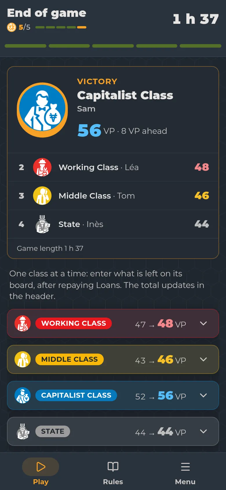
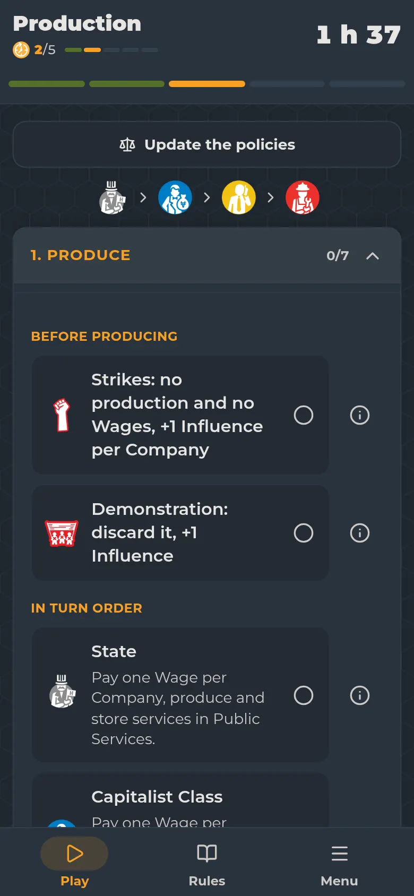
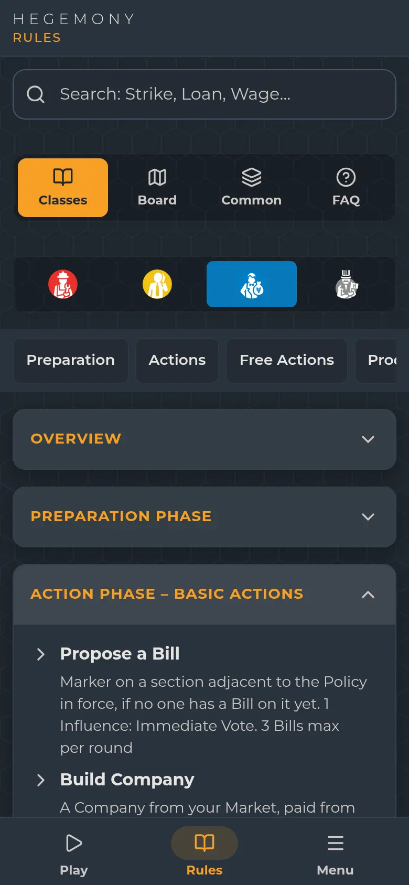
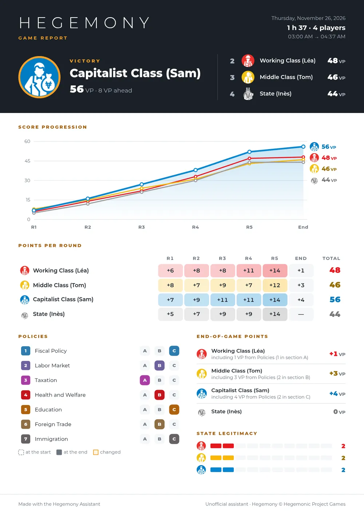

  

<h1 align="center">Hegemony Assistant</h1>

  <strong>An unofficial companion app for the board game <em>Hegemony: Lead Your Class to Victory</em>.</strong> 
  Base game · 2, 3 or 4 players · English and French · free, offline, no account

  <a href="https://madness807.github.io/hegemony-companion/"><strong>Open the app →</strong></a>
  &nbsp;·&nbsp;
  <a href="https://discord.gg/WbK3AGtJee">Discord: feedback and bugs</a>

  
  &nbsp;
  
  &nbsp;
  

## What it does

Put the phone in the middle of the table: the app follows the game with you.

- **Guided setup**: every class's components and the board, step by step, for your player count.
- **Every phase, step by step**: Preparation, Action, Production, Elections, Scoring. Steps to tick, in order, for every class.
- **Taxes worked out**: income tax, employment tax and corporate tax, computed from the Policies in force.
- **Rules and search**: each class's rules, the board zone by zone, the Policies, the FAQ, and a search that understands "strike" or "loan".
- **Results and PDF report**: points every round, the final tally with tie-breaks, then a game report to keep or share (ranking, score progression, Policies).
- **Offline, no account**: nothing to sign up for, nothing sent anywhere. The game stays on your phone, even without a network, with a history of past games.

  

## Install it on your phone

It is a web app (PWA): nothing to get from a store. Installed, it has its own icon, opens full screen and works without a network.

- **Android**: open the link in Chrome, then *Menu → Install app* in the app (or Chrome's ⋮ menu → *Install app*).
- **iPhone / iPad**: open the link in Safari, tap *Share*, then *Add to Home Screen*.

On a computer, the link shows a presentation page with a QR code to scan with your phone.

## Feedback

This is a beta. Found a rule mistake, a bug, or have an idea? Come and say it on the **[Discord](https://discord.gg/WbK3AGtJee)**. The version number is at the bottom of the app's menu: please include it.

## About this repository

This repository only holds the built app, served by GitHub Pages. It is replaced on every release.

---

**En français** : assistant de partie non officiel pour le jeu de société *Hegemony*, en français et en anglais. Mise en place guidée, chaque phase pas à pas, impôts calculés, règles avec recherche, décompte et rapport de partie en PDF, hors ligne et sans compte. [Ouvrir l'app](https://madness807.github.io/hegemony-companion/) · [Discord](https://discord.gg/WbK3AGtJee).

---

Unofficial fan-made companion, not affiliated with the publisher. *Hegemony: Lead Your Class to Victory* is a game by Vangelis Bagiartakis and Varnavas Timotheou, illustrated by Jakub Skop, published by [Hegemonic Project Games](https://hegemonicproject.com/shop/). The game's names and images belong to them. Brand logos from [dashboardicons.com](https://dashboardicons.com/) (Apache-2.0).
